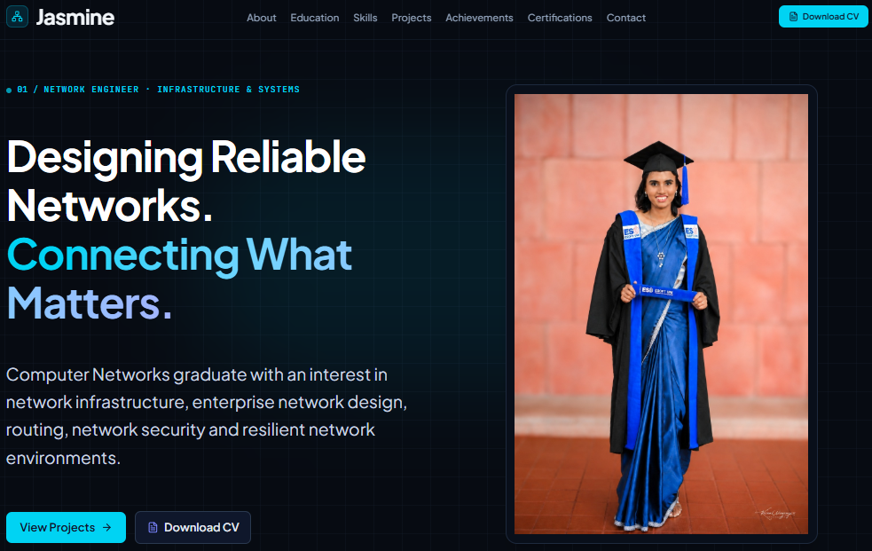

<div align="center">

# YESMIN JALALDEEN

### NETWORK ENGINEER | COMPUTER NETWORKS & INFRASTRUCTURE

**Designing Secure, Scalable and Reliable Networks.**

<p>
  
  
  
</p>

<p>
  
  
  
  
</p>

<p>
  <a href="https://github.com/Jasmine10447">
    
  </a>
  <a href="https://www.linkedin.com/in/yesmin-jalaldeen-6634ba198/">
    
  </a>
</p>

</div>

---

## Portfolio Preview

<div align="center">
  
  <p><em>A professional portfolio showcasing networking expertise, infrastructure projects, technical skills and practical network laboratories.</em></p>
</div>

---

## Table of Contents

- [About the Portfolio](#about-the-portfolio)
- [Key Features](#key-features)
- [Portfolio Sections](#portfolio-sections)
- [Technology Stack](#technology-stack)
- [Featured Network Projects](#featured-network-projects)
- [Network Laboratory Portfolio](#network-laboratory-portfolio)
- [Technical Skills](#technical-skills)
- [Education](#education)
- [Professional Experience](#professional-experience)
- [Project Structure](#project-structure)
- [Getting Started](#getting-started)
- [Available Scripts](#available-scripts)
- [Contact](#contact)

---

## About the Portfolio

This repository contains the personal portfolio website of **Yesmin Jalaldeen**, a Computer Networks graduate with an interest in network infrastructure, enterprise network design, routing, network security and resilient network environments.

The portfolio was developed to present academic knowledge, practical networking experience, technical capabilities and network infrastructure projects in a structured and professional format.

It highlights experience with network design and simulation, enterprise networking technologies, security configurations, network monitoring and troubleshooting tools.

The website provides a central place to explore technical projects, networking laboratories, skills, academic background and professional experience.

---

## Key Features

- **Professional Profile:** A dedicated introduction and overview of networking expertise.
- **Technical Skills:** Organized networking skills, technologies, protocols and tools.
- **Network Projects:** Detailed presentation of academic and practical networking projects.
- **Network Laboratories:** A collection of practical network configuration and simulation scenarios.
- **Experience & Education:** Academic qualifications and professional experience.
- **Certifications Section:** A dedicated area for professional certifications.
- **Responsive Interface:** Designed to provide an accessible browsing experience across screen sizes.
- **Interactive Components:** Interactive project and laboratory content.
- **Resume Access:** Direct access to the professional CV.
- **Contact & Social Links:** Convenient access to professional contact channels.

---

## Portfolio Sections

| Section | Description |
|---|---|
| Hero | Professional introduction and networking specialization |
| About | Background, interests and professional profile |
| Skills | Networking technologies, protocols and technical tools |
| Projects | Featured network infrastructure projects |
| Network Labs | Practical networking laboratory scenarios |
| Achievements | Academic and professional highlights |
| Certifications | Dedicated certification showcase |
| Experience | Professional work experience |
| Resume | Access to the professional CV |
| Contact | Email and professional networking links |

---

## Technology Stack

### Frontend Development

<p>
  
  
  
  
</p>

### Libraries & Tools

- **Motion:** Animations and interactive motion effects.
- **Lucide React:** Icon library.
- **Vite:** Development server and production build tooling.
- **TypeScript:** Static typing and maintainable application code.
- **Git & GitHub:** Version control and source code hosting.

---

## Featured Network Projects

### 1. Design and Simulation of a Secure, Scalable, and Resilient Network Infrastructure using GNS3

**Category:** University Main Project  
**Duration:** August 2024 – August 2025

A simulated enterprise network infrastructure designed with a focus on security, scalability, availability and centralized monitoring.

**Key Technologies:**
- GNS3
- OSPF
- HSRP
- VLAN
- DMZ
- Firewall
- Snort IDS
- Kali Linux
- SNMP

**Project Highlights:**
- Enterprise network segmentation using VLANs and DMZ architecture.
- Dynamic routing implementation using OSPF.
- Gateway redundancy using HSRP.
- Network security and intrusion detection using Snort IDS.
- Centralized network monitoring.

**Repository:** [Enterprise Network GNS3](https://github.com/Jasmine10447/Enterprise_Network_GNS3)

---

### 2. Secure Enterprise Network Design for Avalanch Corporation

Designed a secure enterprise network using Cisco Packet Tracer, incorporating network segmentation, routing, redundancy and security mechanisms.

**Key Technologies:**
- Cisco Packet Tracer
- VLAN and Inter-VLAN Routing
- IPv4 Addressing and VLSM
- OSPF and HSRP
- STP and LACP
- ACLs
- SSH and AAA
- IPsec VPN
- DHCP and Syslog

**Repository:** [Secure Enterprise Network – Avalanch Corporation](https://github.com/Jasmine10447/Secure_Enterprise_Network_Avalanch_Corporation)

---

### 3. Virtual Enterprise Network with pfSense Firewall

Implemented a virtual enterprise network environment using pfSense and virtual machines, focusing on network segmentation, firewall configuration and traffic control.

**Key Technologies:**
- Oracle VirtualBox
- pfSense CE
- Ubuntu
- Lubuntu
- Linux Network Manager
- Virtual WAN and LAN
- NAT
- Firewall Rules

**Repository:** [Virtual Enterprise Network – pfSense Firewall](https://github.com/Jasmine10447/Virtual_Enterprise_Network_Pfsense_Firewall)

---

### 4. WLAN Site Survey – ESOFT Metro Campus

Conducted a wireless network site survey to evaluate Wi-Fi signal strength, channel distribution and coverage across the campus environment.

**Key Technologies:**
- Acrylic Wi-Fi Analyzer
- Acrylic Wi-Fi HeatMap
- EDrawMax
- Microsoft Excel
- RSSI Analysis
- Wireless Channel Analysis
- Wi-Fi Coverage Assessment

**Repository:** [WLAN Site Survey](https://github.com/Jasmine10447/WLAN_Site_Survey)

---

### 5. IronOne Branch Network Design – Kandy Branch

Designed a branch network infrastructure using Cisco Packet Tracer, focusing on IP addressing, subnetting and VLAN-based network organization.

**Key Technologies:**
- Cisco Packet Tracer
- VLAN
- IPv4 Addressing
- VLSM
- Routers
- Switches

**Repository:** [IronOne Branch Network Design](https://github.com/Jasmine10447/IronOne_Branch_Network_Design)

---

## Network Laboratory Portfolio

The portfolio includes practical network laboratory scenarios covering enterprise networking, routing, switching, security and packet analysis.

| No. | Laboratory | Technologies & Concepts |
|---|---|---|
| 01 | Enterprise VLAN & Inter-VLAN Routing | Cisco IOS, VLAN, 802.1Q, Inter-VLAN Routing |
| 02 | OSPF Multi-Area Dynamic Routing | OSPFv2, Area 0, ABR, Route Summarization |
| 03 | Perimeter Security & Extended ACLs | Extended ACL, Stateful Inspection, NAT, DMZ |
| 04 | STP & EtherChannel LACP Redundancy | LACP, Rapid PVST+, Port-Channel, BPDU Guard |
| 05 | Site-to-Site IPsec VPN | IPsec, ISAKMP, Crypto Map, AES-256, SHA |
| 06 | Wireshark Packet Forensics | TCP Three-Way Handshake, ARP, Protocol Analysis |

### Laboratory Tools

- Cisco Packet Tracer
- GNS3
- EVE-NG
- Wireshark
- Cisco IOS
- pfSense

---

## Technical Skills

### Networking Fundamentals
- TCP/IP and OSI Models
- IPv4 Addressing and VLSM
- VLAN and 802.1Q Trunking
- Inter-VLAN Routing
- DHCP and DNS
- NAT/PAT

### Routing & WAN Protocols
- OSPF Routing
- Static Routing
- HSRP Gateway Redundancy

### Enterprise Switching
- Cisco IOS and CLI
- STP and RSTP
- EtherChannel and LACP

### Network Security & Firewalls
- Access Control Lists (ACLs)
- pfSense Firewall
- Firewall and DMZ Architecture
- IPsec VPN
- SSH and AAA
- Snort IDS

### Tools, Emulators & Operating Systems
- Cisco Packet Tracer
- GNS3
- Wireshark
- VirtualBox
- Linux Systems (Ubuntu / Lubuntu)

### Monitoring & Wireless Networking
- SNMP Network Monitoring
- Wi-Fi Site Survey
- Acrylic Wi-Fi Analyzer
- Acrylic Wi-Fi HeatMap

---

## Education

### Bachelor of Information Technology (Honours) in Computer Networks

**ESU ESOFT University, Sri Lanka**  
October 2022 – September 2026

- Graduated with Second Class Upper Division (2:1).
- Cumulative GPA: 3.36.

### BCS Certificate and Diploma Level in Computer Networking

**BCS – The Chartered Institute for IT**  
September 2018 – March 2021

- Completed BCS Certificate Level in Computer Networking (March 2019).
- Diploma Level studies.

### School Education

**Dharmapala Maha Vidyalaya, Kottawa**  
January 2005 – August 2018

- G.C.E. Ordinary Level – 2015
- G.C.E. Advanced Level – 2018
- Extracurricular activities: Badminton and School English Choir.

---

## Professional Experience

### Trainee Insurance Assistant – Motor UW

**Continental Insurance Lanka Limited**  
October 2021 – September 2022

**Responsibilities and Experience:**
- Reviewed motor insurance applications and related documentation.
- Assisted with risk assessment and policy documentation.
- Supported customer communications and service-related activities.
- Conducted market research and assisted with operational tasks.
- Developed communication, teamwork and professional coordination skills.
- Followed organizational procedures and documentation standards.

---

## Project Structure

```text
network-engineer-portfolio/
│
├── public/
│   ├── images/
│   │   └── portfolio-preview.png
│   └── resume/
│       └── Yesmin Jalaldeen_CV.pdf
│
├── src/
│   ├── components/
│   │   ├── AboutSection.tsx
│   │   ├── AchievementsSection.tsx
│   │   ├── CertificationsSection.tsx
│   │   ├── ContactSection.tsx
│   │   ├── ExperienceSection.tsx
│   │   ├── Hero.tsx
│   │   ├── LabsSection.tsx
│   │   ├── Navbar.tsx
│   │   ├── ProjectsSection.tsx
│   │   ├── ResumeSection.tsx
│   │   ├── SkillsSection.tsx
│   │   ├── Footer.tsx
│   │   └── ...
│   │
│   ├── data/
│   │   └── portfolioData.ts
│   │
│   ├── types/
│   │   └── network.ts
│   │
│   ├── App.tsx
│   └── ...
│
├── index.html
├── package.json
├── tsconfig.json
├── vite.config.ts
└── README.md
```

---

## Getting Started

Follow these instructions to run the portfolio locally.

### Prerequisites

Make sure the following software is installed:

- [Node.js](https://nodejs.org/)
- [npm](https://www.npmjs.com/)
- [Git](https://git-scm.com/)
- A code editor such as [Visual Studio Code](https://code.visualstudio.com/)

### 1. Clone the Repository

```bash
git clone https://github.com/Jasmine10447/Jasmine_Jalaldeen_Portfolio.git
```

### 2. Navigate to the Project Directory

```bash
cd Jasmine_Jalaldeen_Portfolio
```

### 3. Install Dependencies

```bash
npm install
```

### 4. Start the Development Server

```bash
npm run dev
```

Open the local URL displayed in your terminal to view the portfolio.

---

## Available Scripts

| Command | Description |
|---|---|
| `npm run dev` | Starts the local development server |
| `npm run build` | Creates the production build |
| `npm run preview` | Previews the production build |
| `npm run lint` | Runs TypeScript checks |

### Production Build

To generate the production-ready application:

```bash
npm run build
```

To preview the production build locally:

```bash
npm run preview
```

---

## Contact

<div align="center">

### Yesmin Jalaldeen

**Network Engineer | Computer Networks & Infrastructure**

Interested in network infrastructure, enterprise network design, routing, network security and reliable network environments.

<p>
  <a href="mailto:jasminejalaldeen10447@gmail.com">
    
  </a>
  <a href="https://github.com/Jasmine10447">
    
  </a>
  <a href="https://www.linkedin.com/in/yesmin-jalaldeen-6634ba198/">
    
  </a>
</p>

---

<sub>Designed and developed to showcase networking knowledge, technical skills and infrastructure projects.</sub>

**© Yesmin Jalaldeen. All Rights Reserved.**

</div>
